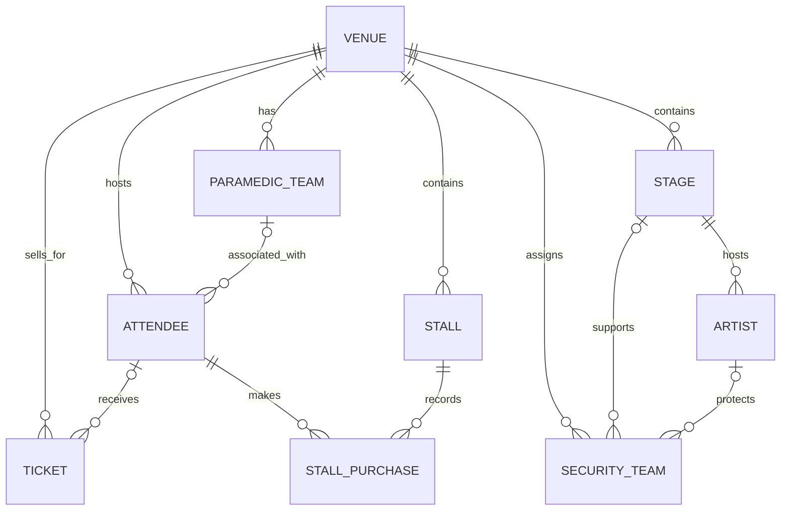

# Entity Relationships

An **entity-relationship diagram (ERD)** is a visual map of a database. It shows the tables, the links between them and how many records can be associated across each link. It helps developers understand and review a database structure.

## Diagram

GitHub renders this Mermaid diagram directly in this Markdown file.

## Relationship summary

| Parent | Child | Meaning |
|---|---|---|
| VENUE | PARAMEDIC_TEAM | A venue can have multiple teams; a team may be unassigned |
| VENUE | STAGE | A venue can contain multiple stages; each stage belongs to one venue |
| VENUE | STALL | A venue can contain multiple stalls; each stall belongs to one venue |
| VENUE | SECURITY_TEAM | A venue can have multiple security teams; a team may be unassigned |
| STAGE | ARTIST | A stage can host multiple artists; an artist may be assigned to one stage or none |
| STAGE / ARTIST | SECURITY_TEAM | A security team may optionally reference a stage and an artist |
| VENUE | ATTENDEE | A venue can be associated with multiple attendees |
| PARAMEDIC_TEAM | ATTENDEE | A team may be associated with multiple attendees; attendee assignment is optional |
| VENUE | TICKET | A venue can have multiple tickets; each ticket references one venue |
| ATTENDEE | TICKET | An attendee may have multiple tickets; a ticket assignment is optional |
| ATTENDEE | STALL_PURCHASE | One attendee can make multiple purchases |
| STALL | STALL_PURCHASE | One stall can have multiple purchase records |

## Notation

- `||` means exactly one.
- `o|` means zero or one.
- `o{` means zero or many.
- `|{` means one or many.

## Modelling note

This diagram documents the portfolio schema implemented in the SQL scripts. It does not replace the original group's approved ERD or business rules. In particular, the optional security assignments do not currently enforce that the selected stage and artist belong to the same venue.
