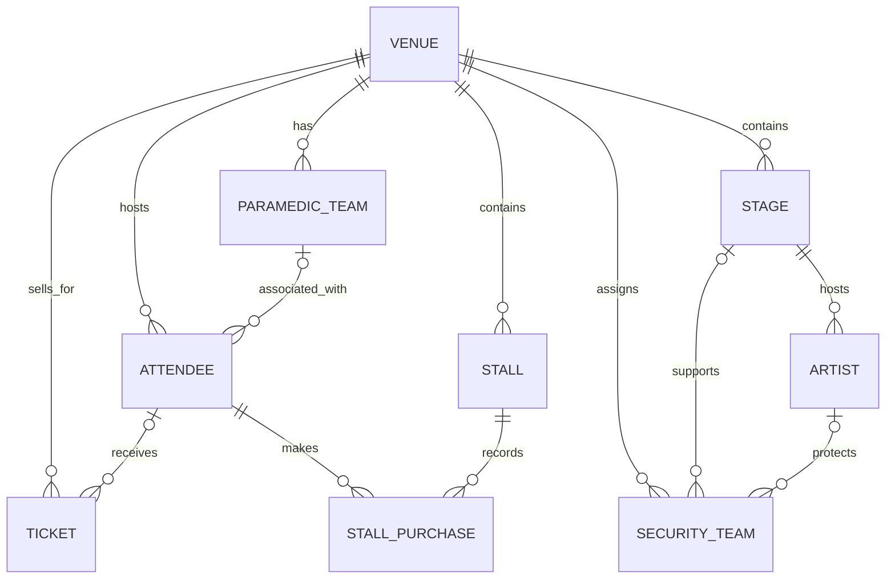

# Entity Relationships

An entity-relationship diagram (ERD) illustrates the structure of a relational database. It identifies the tables, the relationships between them and the number of records that may be associated across each relationship.

## Entity-relationship diagram

## Relationship descriptions

| Parent table | Related table | Relationship |
|---|---|---|
| `VENUE` | `PARAMEDIC_TEAM` | A venue can have multiple paramedic teams. A team may be unassigned. |
| `VENUE` | `STAGE` | A venue can contain multiple stages. Each stage belongs to one venue. |
| `VENUE` | `STALL` | A venue can contain multiple stalls. Each stall belongs to one venue. |
| `VENUE` | `SECURITY_TEAM` | A venue can have multiple security teams. A team may be unassigned. |
| `STAGE` | `ARTIST` | A stage can host multiple artists. An artist may be assigned to one stage or none. |
| `STAGE` / `ARTIST` | `SECURITY_TEAM` | A security team may optionally reference a stage and an artist. |
| `VENUE` | `ATTENDEE` | A venue can be associated with multiple attendees. |
| `PARAMEDIC_TEAM` | `ATTENDEE` | A team can be associated with multiple attendees. An attendee's team assignment is optional. |
| `VENUE` | `TICKET` | A venue can have multiple tickets. Each ticket references one venue. |
| `ATTENDEE` | `TICKET` | An attendee may have multiple tickets. A ticket may be unassigned or assigned to one attendee. |
| `ATTENDEE` | `STALL_PURCHASE` | An attendee can make multiple purchases. Each purchase belongs to one attendee. |
| `STALL` | `STALL_PURCHASE` | A stall can have multiple purchase records. Each purchase belongs to one stall. |

## ERD notation

- `||` — exactly one
- `o|` — zero or one
- `o{` — zero or many
- `|{` — one or many

